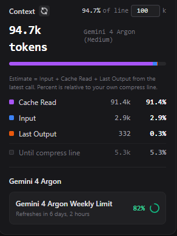
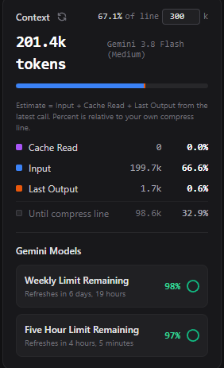
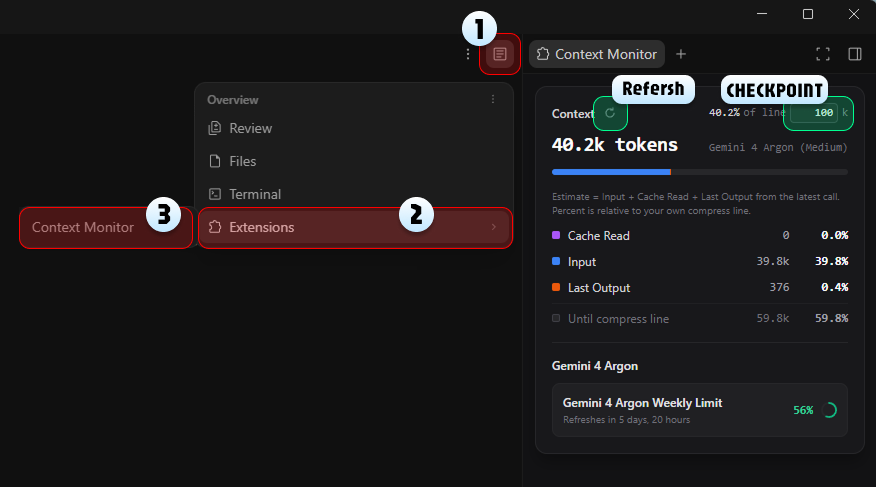

# Antigravity Context & Quota Monitor v1.0.0

一个用于 Antigravity IDE 的本地侧边栏小工具，用来查看**当前对话窗口的上下文 Token 估算用量**、**自定义的手动压缩提醒线（Compress Line）**，以及**当前模型所属分组的剩余配额（Quota）**。

> **免责声明与分享说明（As-Is）**：
> - **个人自用小工具，按现状分享（As-Is）**：不承诺后续维护、修 Bug 或跟进宿主新版本适配。代码非常短（核心只有 `server.mjs` 和 `index.html` 两个文件），**想改随便改，完全自由修改自用**。
> - 本插件为社区自制工具，与 Google 或 Anthropic 无官方关联。以下说明均基于当前版本的插件源码与实际验证结果撰写。

---

| Cache Read 占比较高的示例（Gemini 4 Argon，默认 100k 线） | Input 占比较高的示例（Gemini 3.8 Flash，默认 300k 线） |
| :---: | :---: |
|  |  |

## 中文说明

### 1. 数据来源（它显示什么、从哪读）

1. **当前模型名称**：
   - 从当前对话记录文件 `~/.gemini/antigravity/brain/<conversationId>/.system_generated/logs/transcript.jsonl` 中，提取最后一条 `USER_INPUT` 里的 `<USER_SETTINGS_CHANGE>` 模型切换记录（匹配 `changed setting Model Selection from X to Y.` 或备用 `model:` 字段）。
2. **上下文 Token 数**：
   - 从同一个 `transcript.jsonl` 文件中，读取最后一条模型回复（`PLANNER_RESPONSE`）的三个字段：
     - `input_tokens`（Input / 蓝色输入）
     - `cache_read_tokens`（Cache Read / 紫色缓存读取）
     - `output_tokens`（Last Output / 橙色上次输出）
   - **蓝色 Input 与紫色 Cache Read 的变化观察（作者实测观察与推测，非官方文档结论，仅供参考）**：在日常测试中观察到，平时给 Agent 新发的消息（或首次开口、压缩后的首轮对话）会记录在蓝色的 `Input` 中；当 Agent 回复后，下一轮对话时之前的历史消息通常会转为紫色的 `Cache Read`。从实测配额掉速来看，紫色缓存保持有效时持续对话似乎更省配额；而长时间闲置或中途修改 `GEMINI.md` 全局规则后，曾观察到下一轮紫色缓存归零、历史内容重新计入蓝色 `Input` 的现象。
   - **压缩后刷新说明（基于当前宿主日志观察）**：观察到的 `CHECKPOINT` 总结记录不包含这三个 Token 用量字段，因此仅凭该记录无法更新压缩后的估算值。后续模型回复写入完整用量后，再刷新面板即可看到新数字。
   - **缺一不可**：三项数字只要缺任何一项或格式不合法，面板都会直接显示等待/不可用状态，**绝不用 `0` 充数**。
3. **剩余配额（Quota）**：
   - 底部绿色圆环区域**直接同步显示 Antigravity 官方本机接口的数据**（通过宿主注入本机进程的环境变量 `ANTIGRAVITY_LS_ADDRESS` 与 `ANTIGRAVITY_CSRF_TOKEN`，向本机 Language Server 接口 `/exa.language_server_pb.LanguageServerService/RetrieveUserQuotaSummary` 发起本地请求，并在消除浮点尾数误差后对百分比向下取整，以对齐实测观察到的官方菜单显示）。
   - 根据当前窗口识别出的模型名，自动展示对应分组的配额：
     - **Gemini Models**（Weekly / Five Hour）
     - **Gemini 4 Argon**（Weekly）
     - **Claude and GPT models**（Weekly / Five Hour，Claude 各版本与 GPT 共用该配额池）

### 2. 关于“压缩线（Compress Line）”——这不是官方上限！

- Antigravity 官方目前没有公布各模型的真实上下文上限和自动压缩触发点。因此，**本插件不猜测、也不内置任何假装成官方数据的容量上限**。
- 面板右上角的 `of line [ 100 ] k` 是**你自己设定的手动压缩提醒线**（单位为 `k` tokens，可输入范围 `1–5000`）。
- 初始默认值按模型分组自动设定：**Gemini 4 Argon 默认 `100`k**、**Claude / GPT 默认 `100`k**、**Gemini 3.8 默认 `300`k**。
- 当你手动修改输入框数字时，会按**模型分组**保存在面板页面的 `localStorage`（键名 `compressLineK:group:<group>`，回退为当前页面内存）中，供同一存储域下刷新或切换同组模型时沿用；**不保证跨窗口或重启后保留，其他已打开面板也不会立即同步更新**。面板上的百分比、进度条长度以及 `Until compress line`（距离压缩线剩余量）全部相对于这条线计算。
- **作者个人样本观察（仅供参考，非官方结论或额度保证）**：
  - 在个人使用样本中观察到，上下文越大，单次回复（尤其是带多步工具调用往返）消耗的配额往往越多。
  - **作者本人日常习惯**：**Argon 和 Claude 通常在 `100k` 以内手动压缩**（在作者个人的少量测试样本中，Claude 在 `60k` 左右时曾观察到单次回复消耗在周额度的 `1%` 以内，但实际消耗受具体任务与工具调用影响，不做保证）；**Gemini 3.8 在作者实测中观察到会在 `250k` 左右触发自动压缩**（默认提醒线设为 `300k`，如希望在之前收到提醒可自行调小）。

### 3. 已知局限（使用前必看）

1. **配额显示可能延迟更新**：
   - 面板展示本机接口返回的配额。作者曾观察到，停止对话时显示剩余 `5%`，稍后刷新变为 `0%`；具体扣减时点和原因未独立核实。请将百分比作为参考，避免依赖最后几个百分点安排任务。
2. **仅在打开、切回或手动点击时刷新**：
   - 插件**没有后台定时轮询**。它只在面板初次加载（`DOMContentLoaded`）、面板从隐藏切回可见（`visibilitychange`）、窗口重新获得焦点（`focus`），或你手动点击左上角刷新图标时读取一次最新数据。
3. **部分情况可能显示 `Unknown model`**：
   - 如果某个对话窗口从创建起从未产生过 `<USER_SETTINGS_CHANGE>` 记录，或者包含该记录的 `transcript.jsonl` 行因为过长被宿主截断，插件将无法识别模型名，进而无法自动匹配对应的配额分组。
4. **随 Antigravity 更新可能失效**：
   - 插件强依赖当前宿主日志的文件路径、`transcript.jsonl` 的文本格式以及本机 `RetrieveUserQuotaSummary` 接口。宿主软件更新后如果调整了上述格式，插件可能会失效。

### 4. 目录结构、安装、打开与卸载

- **实测环境**：已在 Windows 平台的 Antigravity 环境中验证；该环境报告的语言服务版本（`ANTIGRAVITY_LS_VERSION`）为 `hub-2.26.0`。macOS、Linux 及其他版本环境尚未验证。
- **手工安装步骤**：
  1. 下载或克隆本仓库 `antigravity-context-monitor`。
  2. 将仓库文件夹重命名（或将其内部文件复制）为 **`context-monitor`**，放置到宿主的插件目录下（请确保 `plugin.json` 直接位于 `context-monitor/` 根目录，不要多套一层父文件夹）：
     - Windows（已验证）：`C:\Users\<用户名>\.gemini\config\plugins\context-monitor\`
     - macOS / Linux（路径结构参考，尚未验证）：`~/.gemini/config/plugins/context-monitor/`
  3. 放置后的目录结构如下：

```text
context-monitor/
├── LICENSE
├── README.md
├── plugin.json
├── 01purple-Argon-context.png
├── 02blue-gemini-context.png
├── 03how-to-use.png
└── sidecars/
    └── context-monitor/
        ├── sidecar.json
        ├── server.mjs
        └── index.html
```

- **启用与打开面板**：
  1. 放入目录后，**重启 Antigravity**。
  2. 按下图标记的 `1 -> 2 -> 3` 顺序打开侧边栏面板：点击右上角 **① 面板菜单按钮** ➔ 选择 **② `Extensions`** ➔ 点击 **③ `Context Monitor`**（图中右上角同时标出了手动刷新按钮与自定义压缩线输入框）：



- **卸载与残留说明**：
  - **卸载顺序**：请**先退出 Antigravity**，再删除本插件的 `context-monitor` 目录，然后重新打开 Antigravity（避免后台服务仍在运行或文件被占用）。
  - **残留说明**：插件自身代码不另行写入配置文件；压缩线设置（`compressLineK:group:<group>`）可能留在宿主的 `localStorage` 中，宿主也可能保留运行日志或缓存。

### 5. 隐私与安全边界

- **当前会话日志的本地读取**：插件根据面板绑定的会话 ID，在本地读取对应的 `transcript.jsonl` 日志。日志可能包含聊天正文；插件会在内存中解析日志，只向面板返回模型名称、Token 用量及读取状态，不展示或上传聊天正文。缺少有效会话绑定时，不扫描其他会话寻找替代数据。
- **本机回环请求限制**：插件页面不加载外部网络资源；配额请求仅允许访问本机回环地址，CSRF Token 仅随该本地请求发送，不写入日志，也不传给前端页面。

### 6. 致谢（Credits）

- **设计参考**: Claude Code (Anthropic)
- **项目负责人**: Aegithalos
- **执行程序员**: Gemini (3.8 Flash, 4 Argon) & Claude (Sonnet 5.5, Opus 5.5)
- **代码审计**: ChatGPT Astra, Sol 6.1

---

## English Guide

An unofficial, local side-panel plugin for Antigravity IDE that displays **estimated context token usage for the current window**, a **user-defined manual compress line**, and **remaining quota for the active model group**.

> **Shared As-Is (Feel Free to Modify)**:
> This is a personal utility shared **as-is**, with no promise of active maintenance, bug fixes, or future host-update compatibility. The entire codebase is just two short files (`server.mjs` and `index.html`) — feel free to fork, tweak, and customize it however you like.

### 1. Where the Data Comes From

1. **Model Name**:
   - Extracted from the latest `<USER_SETTINGS_CHANGE>` block inside `USER_INPUT` entries in `~/.gemini/antigravity/brain/<conversationId>/.system_generated/logs/transcript.jsonl`.
2. **Context Token Counts**:
   - Extracted from the latest `PLANNER_RESPONSE` entry in the same `transcript.jsonl`, requiring all three fields: `input_tokens` (blue), `cache_read_tokens` (purple), and `output_tokens` (orange). If any field is missing or invalid, the panel reports the usage as unavailable rather than substituting `0`.
   - **Blue `Input` vs. Purple `Cache Read` (Author's Live Observation & Inference — for reference only, not official documentation)**: In live testing, new messages sent to the agent (or the first turn after starting/compacting a session) appear as blue `Input`, while prior history typically shifts into purple `Cache Read` on subsequent turns. Based on observed quota consumption, continuing a conversation while purple cache remains active appears to use less quota, whereas extended idle time or mid-conversation edits to `GEMINI.md` have been observed to reset `Cache Read` to `0` and recount history under blue `Input`.
   - **Post-Compaction Refresh (based on observed host logs)**: The observed `CHECKPOINT` summary entries do not contain the three token usage fields, so they alone cannot update the estimate after compaction. Refresh the panel after a subsequent model response records complete usage data.
3. **Remaining Quota**:
   - The green ring section directly mirrors the official quota data returned by the host's local Language Server endpoint (`/exa.language_server_pb.LanguageServerService/RetrieveUserQuotaSummary`, queried via `ANTIGRAVITY_LS_ADDRESS` and `ANTIGRAVITY_CSRF_TOKEN`, with percentages floored to integers after floating-point rounding correction to align with observed native UI display) and grouped into **Gemini Models**, **Gemini 4 Argon**, and **Claude and GPT models**.

### 2. About the "Compress Line" (Not an Official Limit)

- Antigravity does not publish official context window limits or auto-compaction thresholds per model. This plugin **does not hardcode or guess fake official limits**.
- The `of line [ 100 ] k` input in the top-right corner is **your own custom threshold** (in `k` tokens, range `1–5000`), with model-group defaults (**`100`k for Gemini 4 Argon and Claude/GPT**, **`300`k for Gemini 3.8**). Changes are saved per model group in the panel page's `localStorage` (`compressLineK:group:<group>`, with an in-memory fallback) for reuse within the same storage origin; **persistence across windows or restarts is not guaranteed, and other open panels will not immediately sync**.
- All percentages, the segmented progress bar, and `Until compress line` are calculated relative to your custom threshold as a personal reminder for when to run `/compact`.
- **Author's Personal Sample Observations (for reference only, not official limits or guarantees)**: In the author's own usage samples, larger contexts (especially with multi-step tool calls) generally correlated with higher quota drain. The author personally compacts **Gemini 4 Argon and Claude within `100k`** (or around `60k` on Claude, where single-turn drain in a few personal samples was observed within ~1% of weekly quota, though actual usage varies by task). **Gemini 3.8 was observed auto-compacting around `250k`** in the author's live tests.

### 3. Known Limitations

1. **Quota Displays May Update With a Delay**: The panel shows quota returned by the host's local endpoint. The author observed `5%` remaining when stopping a conversation, followed by `0%` on a later refresh; the timing and cause of the deduction were not independently verified. Treat the percentage as a reference rather than a guaranteed real-time balance.
2. **No Background Polling**: Data refreshes only when the panel loads, regains visibility/focus (`visibilitychange` / `focus`), or when you click the Refresh button.
3. **Possible `Unknown model`**: If a conversation log has no `<USER_SETTINGS_CHANGE>` block or if that line was truncated by the host in `transcript.jsonl`, the model name (and its corresponding quota group) cannot be resolved.
4. **May Break on Host Updates**: Log paths, setting text formats, and local Language Server endpoints are internal to Antigravity and may change across updates without notice.

### 4. Installation, Opening & Uninstallation

- **Verified Environment**: Verified in an Antigravity environment on Windows, where the reported language server version (`ANTIGRAVITY_LS_VERSION`) is `hub-2.26.0`. macOS, Linux, and other version environments have not been verified.
- **Manual Installation**:
  1. Download or clone this repository (`antigravity-context-monitor`).
  2. Rename the repository folder (or copy its contents) to **`context-monitor`** and place it inside the host plugins directory (ensure `plugin.json` is directly inside `context-monitor/`, without an extra nested parent folder):
     - Windows (verified): `C:\Users\<username>\.gemini\config\plugins\context-monitor\`
     - macOS / Linux (path reference only, unverified): `~/.gemini/config/plugins/context-monitor/`
- **Enabling & Opening the Panel**:
  1. After placing the folder, **restart Antigravity**.
  2. Follow steps `1 -> 2 -> 3` shown in `./03how-to-use.png` above: click **① the top-right panel menu icon** ➔ select **② `Extensions`** ➔ click **③ `Context Monitor`**.
- **Uninstallation & Residue**:
  - **Uninstall Order**: First **quit Antigravity**, delete the `context-monitor` plugin directory, and then reopen Antigravity (to avoid the background process still running or locking files).
  - **Residue Disclosure**: The plugin's own code does not write separate configuration files; custom compress line settings (`compressLineK:group:<group>`) may remain in the host's `localStorage`, and the host may also retain runtime logs or cache.

### 5. Privacy & Security Boundaries

- **Local Reading of Current Session Logs**: Based on the conversation ID bound to the panel, the plugin reads the corresponding `transcript.jsonl` log locally. The log may contain chat text; the plugin parses the log in memory and returns only the model name, token usage, and read status to the panel without displaying or uploading chat text. When a valid session binding is missing, it does not scan other conversations for fallback data.
- **Loopback-Only Quota Requests**: The plugin page loads no external network resources; quota requests are restricted to local loopback addresses, and the CSRF token is sent only with that local request (never logged or exposed to the frontend).

### 6. Credits

- **Design Inspiration**: Claude Code (Anthropic)
- **Product Designer**: Aegithalos
- **Implementation**: Gemini (3.8 Flash, 4 Argon) & Claude (Sonnet 5.5, Opus 5.5)
- **Code Audit**: ChatGPT Astra, Sol 6.1
